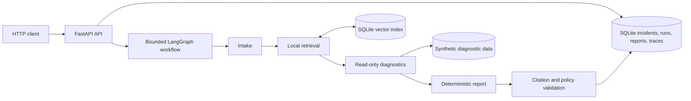

# AgentOps Sentinel

A personal project for evidence-grounded investigation of simulated incidents.
The planned system combines RAG, bounded LangGraph workflows,
typed diagnostic tools, human approval, and reproducible evaluation. It is not a
production incident-response service or an enterprise-certified product.

## Current Status

Phase 2 adds local document retrieval to the working offline investigation:
bounded Markdown ingestion, deterministic lexical hashing embeddings, a
persistent SQLite vector index, resolvable chunk citations, conflict detection, and
read-only knowledge inspection. Incident persistence, four synthetic
diagnostics, the bounded LangGraph workflow, validated reports, and traces remain
local. No paid API or external service is required.

This is a simulation over fixed diagnostics and an eight-document synthetic
corpus, not a general incident diagnosis system. The hashing retriever is a
reproducible lexical RAG baseline, not semantic understanding. A live LLM,
approval execution, evaluation, and a dashboard are not implemented yet.

The application currently consists of:



The complete architecture and product requirements remain in the supplied
[documentation pack](amd_agentic_digital_worker_prd_pack/amd_agentic_digital_worker_prd_pack/00_PROJECT_OVERVIEW.md).
Future directories will be added when their phase is implemented; there are no
placeholder providers or diagnostic tools.

## Local Setup

Requirements: Python 3.12+ and internet access for the initial dependency install.
No GPU, LLM credentials, Docker, or corporate model access is required for Phase 2.
The local verification environment is Windows with Python 3.14.6. CI is configured
for Python 3.12 and 3.14 on Windows and Linux; hosted CI has not run yet.

Run from the repository root in PowerShell with Python 3.12+ on your PATH.
An existing project `.venv` can be reused.

```powershell
python -m venv .venv
.venv/Scripts/python.exe -m pip install --require-hashes -r requirements.lock
.venv/Scripts/python.exe -m pip install --no-deps --no-build-isolation -e .
.venv/Scripts/python.exe -m pip check
.venv/Scripts/python.exe -m uvicorn agentic_worker.main:create_app --factory --host 127.0.0.1 --port 8000 --no-access-log
```

Stop with Ctrl+C. Use a different `--port` if 8000 is occupied. Interactive API
documentation is at http://127.0.0.1:8000/docs and the schema at
http://127.0.0.1:8000/openapi.json.

The default settings work without a `.env` file. Optional values are documented in
[.env.example](.env.example). Do not put secrets in that example or commit a real
`.env`. Environment variables take precedence over `.env` values.

| Variable | Default | Accepted values |
| --- | --- | --- |
| `WORKER_ENVIRONMENT` | `local` | `local`, `test` |
| `WORKER_LOG_LEVEL` | `INFO` | `DEBUG`, `INFO`, `WARNING`, `ERROR` |
| `WORKER_MAX_REQUEST_BYTES` | `65536` | Integer from 1024 to 1048576 |
| `WORKER_DATABASE_PATH` | `agentops.sqlite3` | Local SQLite file path or `:memory:` |
| `WORKER_MAX_GRAPH_STEPS` | `8` | Integer from 1 to 32 |
| `WORKER_MAX_TOOL_CALLS` | `8` | Integer from 1 to 16 |
| `WORKER_TOOL_TIMEOUT_SECONDS` | `2` | Greater than 0, at most 30 |
| `WORKER_PROVIDER_TIMEOUT_SECONDS` | `5` | Greater than 0, at most 60 |
| `WORKER_WORKFLOW_TIMEOUT_SECONDS` | `30` | Graph deadline, greater than 0, at most 120 |
| `WORKER_MAX_PROVIDER_ATTEMPTS` | `2` | Integer from 1 to 3 |
| `WORKER_MAX_TOOL_OUTPUT_BYTES` | `16384` | Integer from 256 to 65536 |
| `WORKER_MAX_REPORT_BYTES` | `65536` | Integer from 256 to 131072 |
| `WORKER_KNOWLEDGE_PATH` | `knowledge` | Versioned local corpus directory |
| `WORKER_VECTOR_STORE_PATH` | `knowledge-index` | Local vector-index directory |
| `WORKER_RETRIEVAL_TOP_K` | `2` | Integer from 1 to 8 |
| `WORKER_RETRIEVAL_MIN_SCORE` | `0.12` | Number from 0 to 1 |
| `WORKER_RETRIEVAL_TIMEOUT_SECONDS` | `3` | Greater than 0, at most 30 |

Unknown `.env` keys and invalid settings fail startup. `WORKER_ENVIRONMENT` is a
configuration label, not authentication or a deployment security boundary.
Request-body limits apply to declared lengths and actual streamed bytes.

The database and vector index are created at startup; relative paths resolve
from the working directory. Parent directories must already exist. Run only one
application process against these SQLite stores: startup marks unfinished runs
as `failed` with `error_code: interrupted`. Recovery is not a distributed worker protocol.
SQLite foreign keys are enforced, and each connection has a five-second lock
wait timeout. No schema migration tooling is provided yet.

Only use synthetic inputs. Incident descriptions and submitted evidence labels
are stored in the local, unencrypted database, even though they are excluded from
application logs. The database and vector index are ignored by Git. On first
startup, an empty index is populated from
[knowledge/manifest.json](knowledge/manifest.json). After changing the corpus,
stop the server and resync explicitly:

```powershell
.venv/Scripts/python.exe -m agentic_worker.retrieval.ingest
```

To reset the demo without deleting data, stop the server and set the database
and vector-store paths to new locations.

## Try An Investigation

With the server running, use a second PowerShell terminal:

```powershell
$base = "http://127.0.0.1:8000/api/v1"
$payload = @{
  title = "Document ingestion returns 502"
  description = "Upload completes but extraction fails with connection errors."
  service = "document-ingestion"
  severity = "high"
  environment = "demo"
  evidence = @("request-id-123")
} | ConvertTo-Json
$incident = Invoke-RestMethod "$base/incidents" -Method Post -ContentType "application/json" -Body $payload
$run = Invoke-RestMethod "$base/incidents/$($incident.incident_id)/runs" -Method Post -ContentType "application/json" -Body '{"mode":"investigate","max_tool_calls":8}'
$run | Format-List
$report = Invoke-RestMethod "$base/runs/$($run.run_id)/report"
$report | ConvertTo-Json -Depth 10
Invoke-RestMethod "$base/runs/$($run.run_id)/trace?offset=0&limit=100" | ConvertTo-Json -Depth 10
```

The known fixture produces `succeeded`, four tool calls, five graph steps, and a
medium-confidence extraction-host hypothesis grounded in diagnostics and a
retrieved runbook chunk. Every recommendation remains
`not_executed` and requires approval. There is no action execution endpoint.
Here `succeeded` means the investigation produced a validated report, not that
the outage was fixed.

The report's four diagnostic source IDs identify records in
[seed_data.json](src/agentic_worker/tools/seed_data.json) and the persisted tool
trace. `knowledge_citations` contain content-addressed chunk IDs, exact character
offsets, hashes, scores, and excerpts that can be resolved through the knowledge
API. The mock matches structured signals and retrieved evidence; it does not
execute document instructions or fetch submitted evidence labels.

For the missing-evidence path, submit the same request with `service` set to
`unknown-service`: the run returns `needs_input` with no hypothesis or action.
Starting a run with `max_tool_calls: 1` produces `blocked` and no report. These are
real workflow outcomes, not HTTP errors. Run creation is synchronous and each
POST creates a new run; there is no background job queue or idempotency key yet.

## API And Logs

| Endpoint | Result |
| --- | --- |
| `GET /api/v1/health/live` | 200, `{"status":"alive"}` |
| `GET /api/v1/health/ready` | 200, `{"status":"ready"}` after startup |
| `POST /api/v1/incidents` | 201, persisted incident with its stable ID |
| `GET /api/v1/incidents/{incident_id}` | 200, stored incident |
| `POST /api/v1/incidents/{incident_id}/runs` | 200, terminal run record |
| `GET /api/v1/runs/{run_id}` | 200, stored run status and counters |
| `GET /api/v1/runs/{run_id}/report` | 200, validated report; 409 if none exists |
| `GET /api/v1/runs/{run_id}/trace` | 200, ordered events; `offset` and `limit` (1-100) |
| `GET /api/v1/knowledge/documents` | 200, indexed document metadata |
| `GET /api/v1/knowledge/chunks/{chunk_id}` | 200, exact stored chunk or 404 |

Readiness returns 503 with `{"status":"not_ready"}` outside the application
lifespan, if any required incident table cannot be queried, or if the local
vector index is unavailable. Liveness remains independent of storage availability.

```powershell
Invoke-RestMethod http://127.0.0.1:8000/api/v1/health/live
Invoke-RestMethod http://127.0.0.1:8000/api/v1/health/ready
```

Each response receives a server-generated `X-Request-ID`. Error responses contain
`code`, `message`, and the matching `request_id`. Validation failures use 422,
oversized bodies 413, unknown resources 404, and unexpected failures 500.
Messages intentionally do not echo rejected inputs or internal exception text;
use the OpenAPI schema to inspect required fields.

Application JSON logs on stdout contain timestamp, level, event, HTTP stage,
request ID, method, matched route template, status code, and duration. Logs exclude
raw request paths, query strings, headers, bodies, and exception messages. Unknown
paths are logged as `unmatched`. Uvicorn access logging is disabled in the startup
command because its normal request-line logs can expose query strings. Run-level
traces record state transitions, retrieved chunks, tool results and source IDs,
provider attempts, durations where measured, and safe failure codes. They do not record request
descriptions, raw exceptions, prompts, or private chain-of-thought. LangSmith
tracing is explicitly disabled around the graph, including when enabled in the
environment, to preserve offline operation and avoid external trace uploads.

The `IncidentCreate` contract accepts a title (1-200 characters), description
(1-10000), service slug (1-100), severity (`low`, `medium`, `high`, `critical`),
environment (`demo` only), and up to 20 evidence references (1-500 each). Strings
are trimmed, unknown fields are forbidden, and types are not silently coerced.
The incident ID is assigned at creation; a separate run ID is assigned when an
investigation starts. The effective tool budget is the smaller of the request
and server limits. Tools run once each in a fixed sequence, so there is no tool
selection loop. Timeouts, size limits, and malformed outputs stop or bound work:

- `succeeded`: a validated report is available.
- `needs_input`: insufficient evidence; a report explains what is missing.
- `blocked`: a step or tool budget was exhausted.
- `degraded`: retrieval or a tool failed, timed out, or exceeded its output limit.
- `failed`: provider/report validation, workflow, or interrupted-run failure.

Failed, blocked, and degraded runs retain their trace but do not expose a report.
Only provider timeouts and malformed structured output are retried, up to the
configured attempt count. Other failures stop immediately. Oversized output is
rejected rather than silently truncated. Detailed error codes appear in the run
record, and unavailable reports return 409.

## Validation

```powershell
.venv/Scripts/python.exe -m pytest -q
.venv/Scripts/python.exe -m ruff check .
.venv/Scripts/python.exe -m ruff format --check .
.venv/Scripts/python.exe -m mypy src tests
.venv/Scripts/python.exe -m build --no-isolation
.venv/Scripts/python.exe -m pip check
.venv/Scripts/python.exe -m pip_audit -r requirements.lock --no-deps --disable-pip --progress-spinner off
```

Tests use in-process HTTP clients and deterministic local inputs, with no LLM or
external service calls. The dependency audit queries a public advisory service
and needs internet access; it is separate from the offline test suite. Build
output is generated under `dist/` and ignored by Git.

Verified locally on 2026-10-23 with Python 3.14.6:

- 72 tests passed, including network-blocked execution, invalid diagnostic and
  document citations, retrieval failures, conflict abstention, budgets,
  deadlines, and restart recovery.
- Ruff lint and formatting passed; strict mypy passed for 41 source files.
- The hash-locked Phase 2 dependency install succeeded.
- Source distribution and wheel built successfully with `--no-isolation`.
- The wheel contains all four unique synthetic diagnostic records.
- `pip check` found no broken requirements.
- The audit identified unresolved critical advisories in Chroma 1.5.9. Chroma
  was replaced with the bounded SQLite vector adapter; the final lock audit
  found no known vulnerabilities.
- A real HTTP demo produced `succeeded`, four tool calls, five graph steps,
  four diagnostic citations, two resolvable knowledge citations, and 19 trace
  events; its action remained `not_executed`.
- A second HTTP demo returned `needs_input` for an unknown service, with no
  hypothesis or recommended action.
- Hosted GitHub Actions, Python 3.12 execution, Docker, and later-phase acceptance
  gates are not claimed as verified.

The vulnerability result is a point-in-time advisory check, not a guarantee that
dependencies are vulnerability-free. Local environments, caches, build artifacts,
editor settings, and AI prompt/interview material are excluded from the repository.

Dependency ranges live in [pyproject.toml](pyproject.toml). Installs use the fully
pinned, hash-checked [requirements.lock](requirements.lock), including development
and build tools. The lock was resolved on Python 3.14; cross-platform and minimum
Python support remain subject to the CI matrix rather than an unverified claim.
To deliberately update dependencies, use pip-compile with `--upgrade`, review the
changes, reinstall, and rerun every check:

```powershell
.venv/Scripts/python.exe -m piptools compile pyproject.toml --extra dev --generate-hashes --allow-unsafe --strip-extras --output-file requirements.lock
```

## Documentation Decisions

The numbered source documents are retained rather than duplicated under `docs/`:

| Original prompt path | Existing source of truth |
| --- | --- |
| `docs/PRD.md` | [01_PRD.md](amd_agentic_digital_worker_prd_pack/amd_agentic_digital_worker_prd_pack/01_PRD.md) |
| `docs/ARCHITECTURE.md` | [02_ARCHITECTURE.md](amd_agentic_digital_worker_prd_pack/amd_agentic_digital_worker_prd_pack/02_ARCHITECTURE.md) |
| `docs/API_SPEC.md` | [03_API_SPEC.md](amd_agentic_digital_worker_prd_pack/amd_agentic_digital_worker_prd_pack/03_API_SPEC.md) |
| `docs/EVALUATION.md` | [04_EVALUATION_TEST_PLAN.md](amd_agentic_digital_worker_prd_pack/amd_agentic_digital_worker_prd_pack/04_EVALUATION_TEST_PLAN.md) |
| `docs/SECURITY.md` | [05_SECURITY_RELIABILITY.md](amd_agentic_digital_worker_prd_pack/amd_agentic_digital_worker_prd_pack/05_SECURITY_RELIABILITY.md) |
| `docs/IMPLEMENTATION_ROADMAP.md` | [06_IMPLEMENTATION_ROADMAP.md](amd_agentic_digital_worker_prd_pack/amd_agentic_digital_worker_prd_pack/06_IMPLEMENTATION_ROADMAP.md) |

Additional scope decisions:

- Incident creation returns an incident ID. Starting an investigation returns a
  separate run ID, following the API resource split rather than US-01's wording.
- The API specification's `/api/v1` base path applies to health endpoints too.
- Initial CI belongs to Phase 0 per the roadmap; container
  builds and expanded deployment checks remain Phase 6.
- Report citations must exactly match collected synthetic observations or
  indexed chunks; knowledge excerpts, hashes, and offsets are resolved before a
  report is accepted. This is reference validation, not general semantic truth
  verification.
- The runtime provider is a deterministic mock with no external API calls;
  a real runtime adapter is a separate Phase 4 integration.

## Limitations And Next Phase

There is no authentication, rate limiter, request-read deadline, approval
execution, Docker setup, or evaluation runner yet. Bind to localhost only.
Public deployment requires authentication,
TLS, server/proxy timeouts, rate limits, and additional review. Schema definitions
are not evidence that workflow safety or citation validity has been implemented.

If startup fails, verify the interpreter, run `pip check`, and check `.env` keys.
If imports fail, reinstall the editable package from the repository root. If
readiness fails, check the database path and permissions and ensure the server
runs the application lifespan. Do not run multiple workers against the demo
database. A dependency warning should be investigated rather than suppressed.

Phase 2 provides the local knowledge corpus, ingestion, chunking, retrieval, and
document-backed citations. Later phases expand tool and approval policies,
integrate a real provider, add evaluation, and containerize deployment.

No license has been selected yet. Evaluation metrics will only be published once
the corresponding features are implemented and verified.