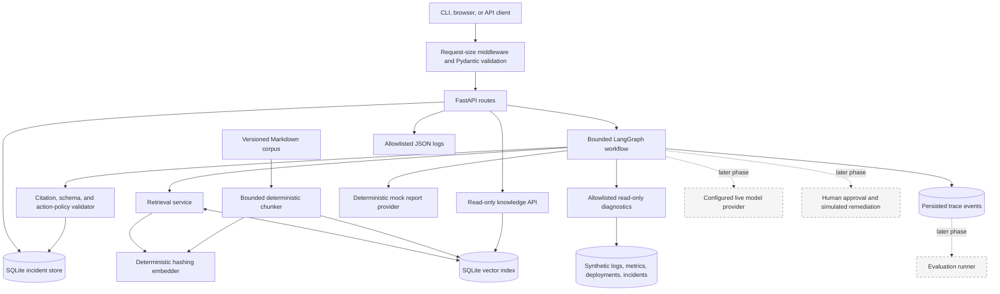
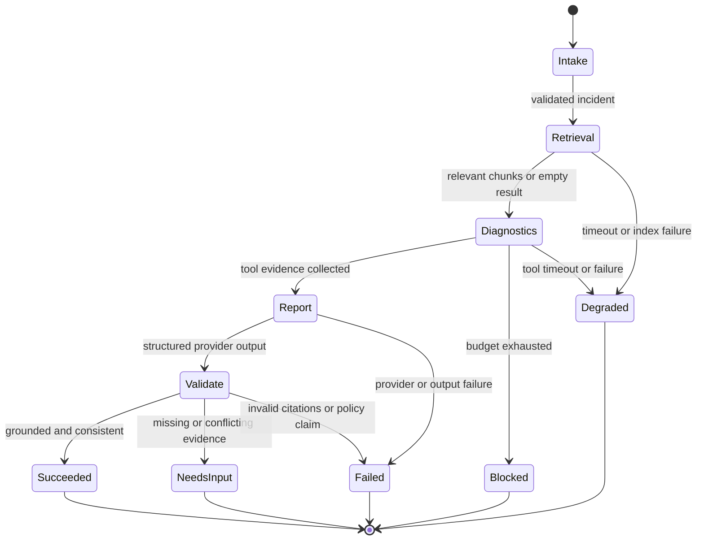
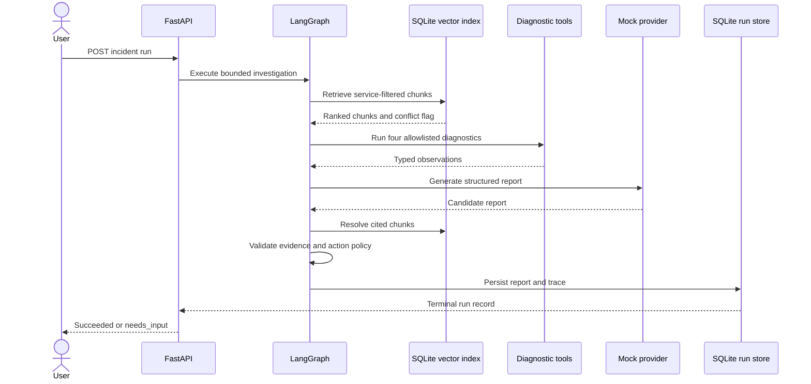

# Architecture and Technical Design

## 1. High-level architecture

The solid nodes below are implemented in Phase 2. Dashed nodes are planned for
later phases and are not runtime claims.



## 2. Design principles

-   Use an explicit state graph; avoid a vague "agent can do anything"
    loop.
-   Separate orchestration from tool implementations and provider SDKs.
-   Keep domain models independent of framework-specific classes where
    practical.
-   Treat LLM output as untrusted until schema validation succeeds.
-   Keep retrieved documents and tool outputs as data, not instructions.
-   Every operation has a deadline, input limit, and observable outcome.
-   Use a deterministic mock provider to make tests reproducible.

## 3. Suggested repository layout

``` text
agentic-digital-worker/
├── README.md
├── pyproject.toml
├── .env.example
├── .gitignore
├── Dockerfile
├── docker-compose.yml
├── Makefile
├── src/agentic_worker/
│   ├── main.py
│   ├── config.py
│   ├── api/
│   │   ├── routes_incidents.py
│   │   ├── routes_runs.py
│   │   ├── routes_approvals.py
│   │   └── schemas.py
│   ├── domain/
│   │   ├── models.py
│   │   ├── enums.py
│   │   └── errors.py
│   ├── orchestration/
│   │   ├── graph.py
│   │   ├── state.py
│   │   ├── nodes.py
│   │   └── policies.py
│   ├── retrieval/
│   │   ├── ingest.py
│   │   ├── chunking.py
│   │   ├── index.py
│   │   └── citations.py
│   ├── llm/
│   │   ├── base.py
│   │   ├── mock_provider.py
│   │   └── providers/
│   ├── tools/
│   │   ├── registry.py
│   │   ├── logs.py
│   │   ├── metrics.py
│   │   ├── incidents.py
│   │   └── simulated_remediation.py
│   ├── persistence/
│   ├── observability/
│   └── evaluation/
├── knowledge/
│   ├── runbooks/
│   └── past_incidents/
├── evals/
│   ├── cases.jsonl
│   └── README.md
├── tests/
│   ├── unit/
│   ├── integration/
│   ├── safety/
│   └── contract/
├── scripts/
├── docs/
│   ├── PRD.md
│   ├── ARCHITECTURE.md
│   ├── API_SPEC.md
│   ├── EVALUATION.md
│   ├── SECURITY.md
│   └── ADR/
└── .github/workflows/ci.yml
```

## 4. Workflow state

Use a typed state object containing: - run_id, incident_id - incident
summary and normalized fields - retrieved evidence references -
diagnostic observations - tool call count and budget - hypotheses and
confidence rationale - remediation plan - approval state - final
report - error/degraded status - stage timing metadata

Do not store hidden chain-of-thought. Store concise rationale,
citations, tool inputs/outputs (redacted and bounded), and state
transitions.

## 5. Workflow graph

The implemented Phase 2 workflow has five bounded stages and terminal outcomes
that are persisted with safe error codes.





Every cycle must have max_steps and max_tool_calls. Detect repeated
identical tool calls and stop loops.

## 6. Tool registry

Each tool definition includes: - name and description - Pydantic input
and output models - permission class: read_only or approval_required -
timeout - maximum output size - retry policy - audit event type -
idempotency behavior where applicable

Initial tools: - search_runbooks(query, service, top_k) -
query_logs(service, time_window, severity, correlation_id) -
query_metrics(service, metric_names, time_window) -
get_recent_incidents(service, limit) - compare_deployments(service,
window) - propose_simulated_remediation(action_type, parameters) -
execute_simulated_remediation(action_id, approval_id) --- must reject
without valid approval - verify_simulated_remediation(action_id)

No generic execute_sql, shell, Python, or arbitrary HTTP tool.

## 7. Provider abstraction

Create a narrow interface: - generate_structured(prompt/context, schema,
timeout) - embed(texts) - provider_name and model_name metadata - usage
metadata when available

Provide a deterministic mock implementation. Provider-specific
implementations should be optional extras and isolated behind adapters.
Never hard-code API keys.

## 8. Persistence

Store: - incidents - runs and status - trace events - retrieval
references - tool invocations - approval decisions - evaluation records

For a first release, SQLModel/SQLAlchemy with SQLite locally is
acceptable. Use PostgreSQL in Docker Compose if it does not delay the
MVP. Document the chosen trade-off.

## 9. Error handling

-   Validate at API boundaries.
-   Use bounded retries only for transient errors.
-   Apply timeouts to LLM, embedding, retrieval, and tools.
-   Distinguish user error, provider error, tool error, policy block,
    and internal error.
-   Return correlation/run IDs for support.
-   Never silently convert failed upload/retrieval/tool operations into
    success.
